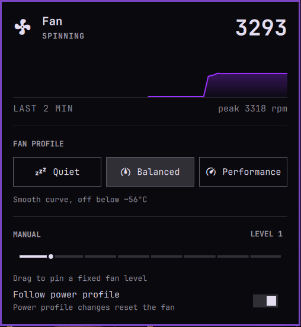

# ThinkPad Fan Control for Omarchy

Control your ThinkPad's fan from the Omarchy bar. One icon opens a panel styled like the built-in wifi and bluetooth
panels, and it follows your theme.

- **Live fan RPM** and a two-minute history graph
- **Three curve profiles**: Quiet, Balanced and Performance, smooth [thinkfan](https://github.com/vmatare/thinkfan)
  curves with hysteresis, so the fan doesn't flutter
- **A manual slider**: off, levels 1 to 7, or full speed
- **Follow power profile**: switch the power profile and the fan profile follows (power-saver is Quiet, balanced is
  Balanced, performance is Performance). Turn it off and your fan setting stays put until you change it

## Quick start

    omarchy plugin add https://github.com/gunz0blazin/omarchy-fan --enable

`omarchy plugin add` shows the usual "plugins run unsandboxed" warning and asks which part of the bar to put the icon
in (it suggests the right side; you can move it later, see [Where it sits in the bar](#where-it-sits-in-the-bar)). Then:

1. Click the fan icon. The first time, the panel shows **Install fan control**.
2. It opens a terminal that installs `thinkfan`, builds a small helper package and installs it (you confirm the
   package and enter your sudo password there), and turns fan control on.
3. Done: the panel now shows live RPM and the controls.

Prefer to do step 2 yourself? Run `install-helper.sh` from the plugin folder
(`~/.config/omarchy/plugins/io.github.gunz0blazin.thinkpad-fan/`).

## Compatibility

| | |
|---|---|
| **Tested on** | ThinkPad T480s (Intel), Omarchy with the shell plugin system |
| **Should work on** | Any ThinkPad that exposes `/proc/acpi/ibm/fan` through `thinkpad_acpi`, Intel or AMD. The curves read the ThinkPad's own embedded-controller temperature, not a CPU-vendor sensor. Not tried on other models yet, reports welcome |
| **Other laptops** | The widget hides itself when there is no `thinkpad_acpi` |
| **Needs** | `power-profiles-daemon` (Omarchy default), `polkit`, `thinkfan` (AUR) |

### Is my ThinkPad supported?

Run `omarchyfan doctor`. It only reads, and prints one line per check (`ok`, `warn` or `FAIL`): the model, whether the
`thinkpad_acpi` driver and its fan control are there, the fan levels, whether the fan speed and the temperature the
curves follow can be read, and whether there is a second fan (the plugin only drives the first). A `FAIL` means it
cannot work on that machine.

**Reporting a new model** (this is how a model gets added to the table):

1. Install the plugin and run `omarchyfan doctor`. It only reads files.
2. Optional, but it lets the model be added as a test fixture: run
   `cat /proc/acpi/ibm/fan /proc/acpi/ibm/thermal; cat /sys/module/thinkpad_acpi/parameters/fan_control`.
3. Optional, on an idle and cool laptop: clone the repo and run `bash tests/test-helper.sh` and
   `bash tests/test-effect.sh`. They briefly change your fan (it gets loud for a few seconds) and restore your profile.
4. Open a [Hardware report](https://github.com/gunz0blazin/omarchy-fan/issues/new?template=hardware-report.yml) issue
   and paste the output into the form. Say whether each profile audibly changes the fan.

A model is marked "Tested" once a report shows `doctor` with no `FAIL` and passing hardware tests, and its raw files are
added to `tests/fixtures/`.

| Model | Status |
|---|---|
| ThinkPad T480s | Tested (the only machine so far) |
| other ThinkPads | Unverified, reports welcome |

## The profiles

Temperatures are the ThinkPad's CPU sensor reading.

| Profile | Fan leaves "off" at | Fan is at full speed above | Feel |
|---|---|---|---|
| Quiet | about 65°C | about 92°C | Silent longest, runs warmest |
| Balanced | about 56°C | about 85°C | Smooth curve, the default |
| Performance | never off (level 1 minimum) | about 74°C | Cooler, spins up early |

These are the files in [`profiles/`](profiles/), one row per fan level as `[level, lower temp, upper temp]`. Manual
mode pins a single level instead of following a curve.

## CLI

The panel calls the same script you can use from a terminal:

    omarchyfan quiet|balanced|performance      # pick a curve
    omarchyfan manual 0-8                      # 0 is off, 8 is full speed
    omarchyfan follow on|off                   # follow the power profile or not
    omarchyfan status
    omarchyfan help                            # opens the manual

The full reference is a man page: `omarchyfan help` or `man omarchyfan` (the source is `man/omarchyfan.1`).

The plugin puts `omarchyfan` on your PATH by itself: the first time the fan widget starts in the bar it links
`bin/omarchyfan` into `~/.local/bin/omarchyfan` (which is on the PATH in Omarchy) and the man page into
`~/.local/share/man/man1/` (which `man` searches by default). Open a new terminal after installing. It never
overwrites a real file with either name, and it fixes the links if the plugin folder moves.

**Legacy name.** The command used to be `omarchy-fan` (with a hyphen). That still works for now, as a small forwarder
(`bin/omarchy-fan`) with its own links and man page, so existing scripts keep working. In a terminal it prints a
one-line notice that the name is old. **It will be removed in a future release**, so switch scripts to `omarchyfan`.

## What it installs, and why

Changing the fan needs root, so the plugin is split in two.

**The plugin runs as you.** `Panel.qml` draws the widget, `bin/omarchyfan` is the CLI the panel calls, and
`bin/omarchy-fan-follow` (started by the panel, stopped when the shell stops) listens for power-profile changes over
D-Bus. Your choices live in `~/.config/omarchy/fan/`. The follower also makes the links described under
CLI (`omarchyfan` and its man page, plus the legacy `omarchy-fan` pair), the only files the plugin writes outside its own
folder and `~/.config/omarchy/fan/`.

**A small root helper, as a normal pacman package** (`omarchy-fan-helper`, built from
[`packaging/PKGBUILD`](packaging/PKGBUILD) on your machine). It installs exactly these files:

| File | What it is |
|---|---|
| `/usr/lib/omarchy-fan/helper` | The only thing that runs as root. It accepts `set quiet\|balanced\|performance`, `set manual 0-8`, `enable`, or `ensure-module` (run by thinkfan's service, see below), and rejects everything else. It never takes a path or config from the caller: it builds `/etc/thinkfan.yaml` from the root-owned profiles below |
| `/usr/share/omarchy-fan/profiles/*.yaml` | The three curves |
| `/usr/share/polkit-1/actions/org.omarchy.fan.policy` | Lets a user in a local, active session run that one helper without a password, the way screen brightness works. There is no sudoers rule |
| `/usr/lib/modprobe.d/omarchy-fan.conf` | `options thinkpad_acpi fan_control=1`, which thinkfan needs whenever the driver is loaded normally |
| `/usr/lib/systemd/system/thinkfan.service.d/omarchy-fan.conf` | Turns off systemd's start rate limit (moving the slider restarts thinkfan), and runs the helper's `ensure-module` just before thinkfan starts: at boot the driver is usually loaded early, from the initramfs, without `fan_control=1`, and thinkfan refuses to start until it is reloaded with it. A failure there never stops thinkfan from starting |

Worth knowing:

- `install-helper.sh` installs `thinkfan` with `omarchy-pkg-aur-add`, which uses `yay --noconfirm` and so **skips the
  PKGBUILD review prompt**. If you want to read it first, install thinkfan yourself (`yay -S thinkfan`) before you
  press the button, and the script will skip that step.
- If you already have your own `/etc/thinkfan.yaml`, the helper saves the first copy as
  `/etc/thinkfan.yaml.omarchy-fan.bak` before it writes a profile. Installing the helper alone never replaces it.
  Restore with `sudo cp /etc/thinkfan.yaml.omarchy-fan.bak /etc/thinkfan.yaml`.
- Everything is a plain package: `pacman -Ql omarchy-fan-helper` lists it, `pacman -Rns omarchy-fan-helper` removes it.
- With thinkfan running, the ThinkPad's firmware still has its own thermal protection, and every profile reaches full
  speed well below the CPU's critical temperature.

## Uninstall

This removes everything the plugin put on your system, and nothing else:

    omarchy plugin remove io.github.gunz0blazin.thinkpad-fan
    rm -f ~/.local/bin/omarchyfan ~/.local/share/man/man1/omarchyfan.1   # the links the plugin made
    rm -f ~/.local/bin/omarchy-fan ~/.local/share/man/man1/omarchy-fan.1 # ...and the legacy ones
    rm -rf ~/.config/omarchy/fan                 # your saved choices (profile, manual level, follow switch)
    sudo systemctl disable --now thinkfan        # gives the fan back to the firmware
    sudo pacman -Rns omarchy-fan-helper $(pacman -Qq thinkfan thinkfan-debug 2>/dev/null)
    sudo rm -f /etc/thinkfan.yaml                # the curve the helper wrote
    rm -rf ~/.cache/yay/thinkfan                 # the build cache from installing thinkfan

- The `pacman` line removes the helper, its polkit policy, curves and drop-ins, and also `thinkfan` and the
  `thinkfan-debug` package the AUR build adds, plus any dependency nothing else needs. **If you used thinkfan before
  this plugin and want to keep it, delete `$(pacman -Qq thinkfan thinkfan-debug 2>/dev/null)` from that line.**
- If you had your own `/etc/thinkfan.yaml` before, the helper saved it as `/etc/thinkfan.yaml.omarchy-fan.bak`: put
  it back with `sudo mv /etc/thinkfan.yaml.omarchy-fan.bak /etc/thinkfan.yaml` (that file is only there in that case).

Removing the plugin alone does **not** stop thinkfan: the fan keeps running on the last curve you chose until you
disable the service.

## Configuration

There is nothing to set in `shell.json`: you choose everything in the panel, with the [command](#cli), or in the files
below.

| What | How |
|---|---|
| Fan profile (Quiet, Balanced, Performance) | the panel's profile buttons, or `omarchyfan quiet\|balanced\|performance` |
| A fixed fan level | the panel's slider, or `omarchyfan manual 0-8` |
| Follow the power profile | the panel's switch, or `omarchyfan follow on\|off` (stored as the file `~/.config/omarchy/fan/no-follow`) |
| Where the icon sits in the bar | `omarchy bar move io.github.gunz0blazin.thinkpad-fan --section right` (also `--index N`), see below |
| The curves themselves | edit the thinkfan files, see below |

Your choices are kept in `~/.config/omarchy/fan/` and survive reboots.

### Where it sits in the bar

`omarchy plugin add` asks, and suggests the right side. To change it later:

    omarchy bar move io.github.gunz0blazin.thinkpad-fan --section right
    omarchy bar move io.github.gunz0blazin.thinkpad-fan --section center --index 0

### The curves

The helper reads the installed copies in `/usr/share/omarchy-fan/profiles/`. Edit those, or fork this repo, change
`profiles/`, and rebuild with `cd packaging && makepkg -si`.

## Troubleshooting

- **`omarchyfan: command not found`:** the link is made when the fan widget first starts, so open a new terminal after
  installing, and check `ls -l ~/.local/bin/omarchyfan` and that `~/.local/bin` is on your PATH. You can always run
  it by its full path: `~/.config/omarchy/plugins/io.github.gunz0blazin.thinkpad-fan/bin/omarchyfan status`.
- **No icon in the bar:** it only appears on a ThinkPad. Check `ls /proc/acpi/ibm/fan`. If it's there but the icon
  isn't, make sure the plugin is in a bar section, and move it with
  `omarchy bar move io.github.gunz0blazin.thinkpad-fan --section right`.
- **Panel says "Enable fan control":** the helper is installed but thinkfan isn't running, or `fan_control` is off.
  Press the button, or run `pkexec /usr/lib/omarchy-fan/helper enable`.
- **The fan setting keeps resetting:** turn off "Follow power profile". Any power profile change, from any source,
  resets the fan while it's on.
- **`fan_control` still says N:** check `cat /sys/module/thinkpad_acpi/parameters/fan_control`. If the module couldn't
  be reloaded, reboot once.
- **A reading of 65535 RPM:** the controller reports that for a moment while the fan changes speed. The plugin ignores
  it.

## Development and tests

All the tests live in `tests/` and are run by hand. They are grouped by how much they touch, so you can pick:

| Tier | What it may touch | Scripts |
|---|---|---|
| **static** | reads files only | `tests/check.sh`, `tests/check-marketplace.sh`, `tests/test-readme.sh`, `tests/test-package.sh`, `tests/test-compat.sh` |
| **local** | a throwaway home directory | `tests/test-cli-link.sh` |
| **shell** | briefly uses, and for one test disables and re-enables, the plugin in your running bar | `tests/test-panel.sh`, `tests/test-follow.sh` |
| **hardware** | changes your fan profile (and, for the follower test, your power profile), then restores them | `tests/test-helper.sh`, `tests/test-effect.sh` |
| **destructive** | needs sudo; stops and kills thinkfan on purpose, then starts it again; removes the plugin and puts it back | `tests/test-failsafe.sh`, `tests/test-uninstall.sh` |

What each one checks:

- `check.sh`: manifest validation, shell syntax and executable bits, man-page lint, the curve files' shape, QML lint.
- `check-marketplace.sh`: this checkout against the marketplace publishing and development rules (manifest fields, id rules,
  README sections and disclosures, symlinks, the security-baseline patterns).
- `test-readme.sh`: the README and man page against the code: documented subcommands exist, documented paths are real,
  the numbers in the profile tables match the curve files, every test script is listed, links resolve.
- `test-package.sh`: builds the root-helper package in a scratch folder and checks exactly what it installs (files,
  owners, modes, the polkit policy, no sudoers rule). Nothing is installed.
- `test-compat.sh`: `omarchyfan doctor` and `stats` against fake `/proc` and `/sys` trees in `tests/fixtures/` (the tested
  T480s, plus a second fan, `fan_control` off, a 65535 speed glitch, missing files and a non-ThinkPad). Runs on any
  machine; to add a model, see `tests/fixtures/README.md`.
- `test-cli-link.sh`: the command and man-page links the plugin makes, in a fake home. Includes the legacy `omarchy-fan` checks.
- `test-panel.sh`: the panel opens and closes (also with Escape and toggle), the shell log shows no errors from the
  plugin, and the plugin survives being disabled and re-enabled with its icon back in the same place. `SKIP_CYCLE=1`
  skips the disable/enable part.
- `test-follow.sh`: the power-profile follower. Don't plug or unplug the charger while it runs.
- `test-helper.sh`: each curve applies, manual levels reach the kernel, nine rapid restarts don't break thinkfan, and
  the root helper rejects bad input without changing anything.
- `test-effect.sh`: the fan really speeds up, slows down and stops (RPM, not just the requested level). Run it on an
  idle laptop; the fan gets loud for a few seconds.
- `test-failsafe.sh`: after thinkfan is stopped (cleanly or killed), the fan returns to firmware control once the
  ThinkPad's 120 s fan watchdog fires. Takes about five minutes. A crash leaving the fan at its last level until then,
  and thinkfan not restarting itself, are recorded as known gaps.
- `test-uninstall.sh`: runs the README's own Uninstall commands, then checks nothing of the plugin is left on the system
  (packages, files, links, saved state, services, the bar entry, anything else with its name), and installs the plugin
  again afterwards. Needs sudo, network and an idle laptop; takes a few minutes.

Every script prints `passed`, `failed` and `skipped` counts, so a skipped check can't pass for a real one. A script that
cannot run on this machine (not a ThinkPad, no sudo, no plugin in the bar) exits with status 77 and says why. The
scripts also work on older versions of the repo (they find the command under either name), which is how a release can
be compared with the one before it. `tests/lib.sh` holds the shared helpers.

## Credits and license

MIT, see [LICENSE](LICENSE). The panel is built from the stock Omarchy UI components so it matches the built-in panels.
Fan curves are driven by [thinkfan](https://github.com/vmatare/thinkfan).
